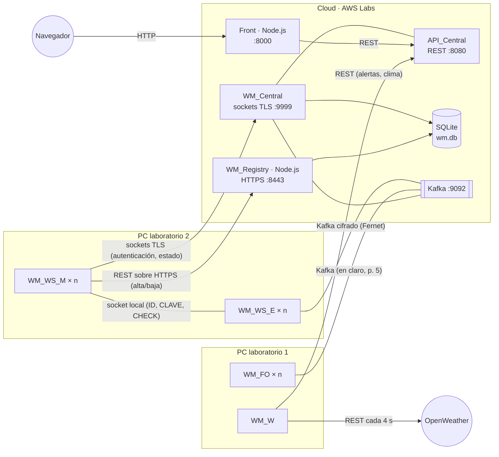
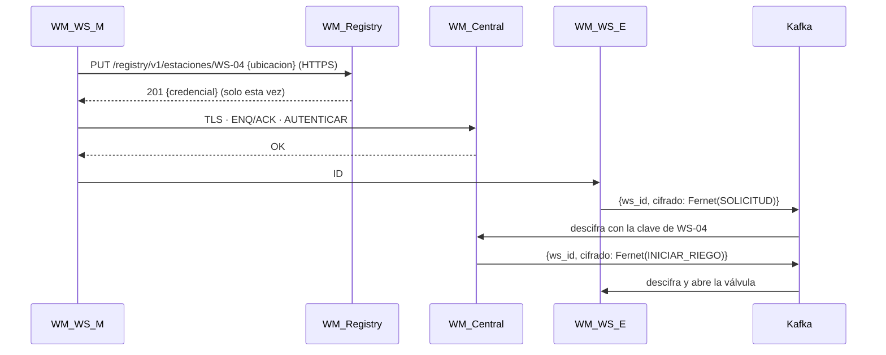

# Release 2 · Arquitectura y decisiones técnicas

Documento de diseño previo a la implementación. Lo que aquí aparece como
contrato (mensajes, endpoints, esquema) es la **propuesta de partida** de cada
Issue: si al implementarlo cambia algo, se actualiza este documento en el mismo
Pull Request. La documentación de Release 1 (`docs/DISENO.md`,
`docs/COMUNICACIONES.md`, `docs/PERSISTENCIA.md`, `docs/DESPLIEGUE_AWS.md`) no
se modifica: describe el sistema base.

## 1. Arquitectura actual (Release 1, commit `07a4dbd`)

| Componente | Código | Responsabilidad | Comunicaciones |
|---|---|---|---|
| WM_Central | `WM_Central/WM_Central.py` | Servidor TCP concurrente de Monitores, consumidor/productor Kafka, estado en memoria (`RegistroConexiones`), SQLite. | Sockets TCP :9999 (Monitor), Kafka, SQLite. |
| Gestor de riegos | `WM_Central/gestor_riegos.py` | Ciclo de riego: solicitud → reserva → `INICIAR_RIEGO` → telemetría → resumen; cortes por fuga, bloqueo, desconexión; `ESTADO_RED` cada 2 s. | Kafka (vía función `publicar`). |
| Panel web | `WM_Central/panel_web.py`, `panel/index.html` | `GET /`, `GET /api/estado`, `POST /api/orden` (INICIAR/BLOQUEAR/ACTIVAR), sin autenticación. | HTTP :8080 (stdlib `http.server`). |
| Panel remoto | `WM_Central/panel_remoto.py` | Sirve el panel desde otra máquina (ECS) y reenvía las dos rutas a CENTRAL. | HTTP. |
| Monitor | `WM_WS/WM_WS_M.py` | `REGISTRO#id#ubicacion`, `PING` cada 2 s, `AVERIA`/`RESUELTA`; servidor del Engine (`ID`, `CHECK` cada 1 s). Sin menú. | Sockets con CENTRAL y con el Engine. |
| Engine | `WM_WS/WM_WS_E.py` | Electroválvula y caudalímetro simulados, menú, persistencia local del riego, reenvío de pendientes. | Socket con Monitor, Kafka. |
| Operario | `WM_FO/WM_FO.py` | Solicitudes manuales o desde fichero, notificaciones y estado de la red. | Kafka. |
| Común | `common/` | Protocolo `<STX>DATA<ETX><LRC>` con ACK/NACK/ENQ/EOT (`protocolo.py`), Kafka JSON (`kafka_utils.py`), SQLite (`base_datos.py`), consola, validaciones, latido. | — |
| Persistencia | `common/base_datos.py` | Tablas `operarios`, `estaciones`, `riegos`; WAL; conexión por operación. Altas con `scripts/gestionar_bd.py`. | Fichero `data/wm.db`. |
| Despliegue | `Dockerfile`, `docker-compose.yml`, `deploy/arrancar_aws.sh`, `.github/workflows/deploy.yml` | Imagen única; CENTRAL + Kafka 3.9.1 (KRaft) en EC2; CI que construye y publica en Docker Hub (sin ejecutar pruebas). | — |

Topics: `wm.peticiones` (FO/Engine → CENTRAL), `wm.ordenes` (CENTRAL → Engine),
`wm.eventos_ws` (Engine → CENTRAL), `wm.notificaciones` (CENTRAL → FO),
`wm.estado_red` (CENTRAL → FO y Engine, latido).

Seguridad actual: ninguna. Sockets, Kafka y HTTP en claro; el panel acepta
órdenes de cualquiera; no hay credenciales ni cifrado.

## 2. Arquitectura objetivo (Release 2)

| Componente | Ubicación (p. 9) | Tecnología | Puerto | Estado |
|---|---|---|---|---|
| WM_Central + API_Central | Cloud (AWS EC2) | Python, mismo proceso | 9999 (sockets TLS), 8080 (REST) | Se amplía |
| WM_Registry | Cloud | **Node.js + Express** (`https`, `node:sqlite`) | 8443 (HTTPS) | Implementado ([#3](https://github.com/aggg15/Sistemas-Distribuidos/issues/3)) |
| Front | Cloud | **Node.js + Express** (estático + proxy de solo consulta a API_Central) | 8000 | Implementado ([#22](https://github.com/aggg15/Sistemas-Distribuidos/issues/22)); dashboard completo en [#23](https://github.com/aggg15/Sistemas-Distribuidos/issues/23) |
| Kafka | Cloud | apache/kafka 3.9.1 | 9092 | Sin cambios (seguridad nativa opcional) |
| SQLite | Cloud (volumen `wm-datos`) | `sqlite3` (CENTRAL) y `node:sqlite` (Registry) | — | Esquema ampliado; compartido por CENTRAL y Registry. Lo define `common/base_datos.py` |
| WM_FO (varios) | PC laboratorio 1 | Python | — | Sin cambios funcionales |
| WM_W | PC laboratorio 1 | Python + `urllib` | — | Nuevo |
| WM_WS_M + WM_WS_E (varias) | PC laboratorio 2 | Python | 9100+ (Engine local) | Se amplían |
| OpenWeather | Internet | REST (HTTPS) | 443 | Externo |



### Secuencia: alta, autenticación y primer riego



### Secuencia: revocación y alerta climática

```mermaid
sequenceDiagram
    participant O as Operador (panel de CENTRAL)
    participant A as API_Central
    participant C as WM_Central
    participant M as WM_WS_M
    participant E as WM_WS_E
    participant W as WM_W
    O->>A: DELETE /api/v1/estaciones/WS-04/clave (token)
    A->>C: revocar_clave(WS-04) → FUERA_SERVICIO
    M->>C: PING#WS-04
    C-->>M: KO#CLAVE_REVOCADA
    M->>E: REVOCADA (descarta la clave)
    Note over M: El operador elige «Autenticarse» en el menú → clave nueva
    W->>A: PUT /api/v1/alertas/WS-05 {motivo: HELADA}
    A->>C: alerta_clima(WS-05, activa)
    C->>E: PARADA_CLIMA (cifrada)
    Note over E: El riego en curso termina normalmente; después FUERA_SERVICIO
    W->>A: DELETE /api/v1/alertas/WS-05
    C->>E: REANUDAR_CLIMA → DISPONIBLE
```

## 3. Contratos propuestos

### 3.1 WM_Registry (HTTPS, prefijo `/registry/v1`) — [#3](https://github.com/aggg15/Sistemas-Distribuidos/issues/3)

Implementado en `WM_Registry/` con Node.js + Express, siguiendo el tutorial de
la asignatura ([TUTORIAL_API_REST.md](TUTORIAL_API_REST.md)).

| Método y ruta | Autenticación | Cuerpo | Respuesta |
|---|---|---|---|
| `GET /estaciones` | Ninguna | — | `200 [{"ws_id", "ubicacion", "estado_registro", "fecha_alta", "fecha_baja"}]` |
| `PUT /estaciones/{ws_id}` (alta) | Ninguna | `{"ubicacion": "Alicante"}` | `201 {…, "credencial"}` y `Location`; `409` si ya está en ALTA con credencial |
| `PUT /estaciones/{ws_id}` (cambio de ubicación) | `Bearer <credencial>` | `{"ubicacion": "Elche"}` | `200` datos públicos; `401` |
| `GET /estaciones/{ws_id}` | `Authorization: Bearer <credencial>` | — | `200` datos públicos; `401`; `404` |
| `DELETE /estaciones/{ws_id}` | `Bearer <credencial>` | — | `204` (baja lógica); `401`; `404` |
| `POST /estaciones/{ws_id}/autenticacion` | `Bearer <credencial>` | — | `200 {"ws_id", "autenticada": true}` / `401` |

Errores: `{"error": "texto"}` con 400, 401, 404, 409, 413, 503 (BD bloqueada) y
500. Los IDs se pasan a mayúsculas y se validan con el criterio de
`campo_valido` de R1 (sin `#`, máximo 32 caracteres; ubicación, 100). El hash
PBKDF2 tiene el formato de `common/seguridad.py`, así que CENTRAL verifica en
Python lo que el Registry generó en Node.js (probado en los dos sentidos). Tras
la baja, `conectar_estacion` devuelve `None` y CENTRAL responde
`KO#WS_NO_REGISTRADA`.

### 3.2 Sockets CENTRAL ↔ Monitor sobre TLS — [#6](https://github.com/aggg15/Sistemas-Distribuidos/issues/6), [#7](https://github.com/aggg15/Sistemas-Distribuidos/issues/7), [#10](https://github.com/aggg15/Sistemas-Distribuidos/issues/10)

El protocolo ENQ/ACK, `<STX>DATA<ETX><LRC>`, ACK/NACK y EOT no cambia: solo se
ejecuta dentro de un `ssl.SSLSocket`.

| Petición del Monitor | Respuesta de CENTRAL |
|---|---|
| `AUTENTICAR#<ws_id>#<credencial>` | `OK#<ws_id>#<clave>` · `KO#WS_NO_REGISTRADA` · `KO#WS_DADA_DE_BAJA` · `KO#CREDENCIAL_INVALIDA` · `KO#ID_EN_USO` · `KO#ERROR_BD` |
| `PING#<ws_id>` | `OK` · `KO#CLAVE_REVOCADA` (y cierre de la sesión) |
| `AVERIA#<ws_id>` / `RESUELTA#<ws_id>` | `OK` |
| `REGISTRO#<ws_id>#<ubicacion>` | Solo en modo compatibilidad R1 (`--sin-seguridad`), para pruebas. |

### 3.3 Monitor ↔ Engine — [#8](https://github.com/aggg15/Sistemas-Distribuidos/issues/8)

| Petición del Monitor | Respuesta del Engine |
|---|---|
| `ID#<ws_id>` | `OK` |
| `CLAVE#<clave>` (tras cada autenticación) | `OK` |
| `REVOCADA` | `OK` (descarta la clave; no publica ni acepta órdenes) |
| `CHECK` (cada segundo) | `OK` / `KO` |

### 3.4 Mensajes Kafka cifrados — [#9](https://github.com/aggg15/Sistemas-Distribuidos/issues/9)

```json
{"ws_id": "WS-04", "cifrado": "gAAAAABn...token Fernet..."}
```

Dentro del token va el mensaje JSON de Release 1 sin cambios. Se cifran
`wm.ordenes` (CENTRAL → Engine), `wm.eventos_ws` (Engine → CENTRAL) y las
solicitudes de `wm.peticiones` con origen WS. Siguen en claro las solicitudes y
notificaciones del FO (p. 5) y `wm.estado_red` (decisión D8). Órdenes nuevas
para el clima: `PARADA_CLIMA` y `REANUDAR_CLIMA` ([#15](https://github.com/aggg15/Sistemas-Distribuidos/issues/15)).

### 3.5 API_Central (prefijo `/api/v1`) — [#12](https://github.com/aggg15/Sistemas-Distribuidos/issues/12), [#16](https://github.com/aggg15/Sistemas-Distribuidos/issues/16), [#17](https://github.com/aggg15/Sistemas-Distribuidos/issues/17), [#18](https://github.com/aggg15/Sistemas-Distribuidos/issues/18)

| Método y ruta | Uso | Acceso |
|---|---|---|
| `GET /estado` | Resumen: Kafka, número de WS por estado, alertas activas | Público |
| `GET /estaciones` · `GET /estaciones/{ws_id}` | Registro, conexión, estado y motivo, clave vigente (sí/no, fecha), alerta, riego en curso | Público |
| `GET /operarios` | Operarios dados de alta, última actividad, riegos en curso | Público |
| `GET /riegos?activos=1` · `GET /riegos/{id}` | Riegos en curso e historial | Público |
| `GET /eventos` · `GET /auditoria` | Últimos eventos y auditoría con filtros | Público / token (decidir en [#18](https://github.com/aggg15/Sistemas-Distribuidos/issues/18)) |
| `GET /clima` · `GET /alertas` | Últimas lecturas de WM_W y alertas activas | Público |
| `PUT /estaciones/{ws_id}/estado` | `{"accion": "BLOQUEAR"}` o `{"accion": "ACTIVAR"}` | Token de operación |
| `POST /riegos` | `{"ws_id", "duracion_s"}` | Token de operación |
| `DELETE /estaciones/{ws_id}/clave` | Revocar («restaurar») claves | Token de operación |
| `PUT /alertas/{ws_id}` · `DELETE /alertas/{ws_id}` | Alerta climática y cancelación | Token de WM_W |
| `PUT /clima/{ws_id}` | Lectura informativa de WM_W | Token de WM_W |

Se mantienen `GET /api/estado` y `POST /api/orden` de Release 1.

### 3.6 Esquema SQLite — [#1](https://github.com/aggg15/Sistemas-Distribuidos/issues/1), [#14](https://github.com/aggg15/Sistemas-Distribuidos/issues/14)

Columnas nuevas de `estaciones` (añadidas con `ALTER TABLE` si faltan):

| Columna | Tipo | Uso |
|---|---|---|
| `estado_registro` | TEXT `ALTA`/`BAJA`, por defecto `ALTA` | Baja lógica (no se borra: `riegos` referencia la estación) |
| `credencial_hash` | TEXT NULL | `pbkdf2_sha256$iter$sal$hash`; NULL en filas de R1 hasta pasar por el Registry |
| `fecha_alta`, `fecha_baja` | TEXT NULL | ISO 8601 UTC |
| `clave_cifrado` | TEXT NULL | Clave Fernet vigente; NULL = sin clave o revocada |
| `clave_emitida` | TEXT NULL | Fecha de emisión (se muestra en el Front, la clave nunca) |
| `alerta_clima` | INTEGER 0/1 | Suspensión por clima, persistente |
| `alerta_detalle` | TEXT NULL | JSON con motivo, ciudad y temperatura |

Tabla nueva `auditoria (id, fecha, origen_tipo, origen_id, ip, accion, resultado, detalle)`.

### 3.7 Catálogo de acciones de auditoría — [#14](https://github.com/aggg15/Sistemas-Distribuidos/issues/14), [#18](https://github.com/aggg15/Sistemas-Distribuidos/issues/18)

`AUTH_OK`, `AUTH_KO`, `REGISTRY_ALTA`, `REGISTRY_BAJA`, `REGISTRY_KO`,
`CLAVE_EMITIDA`, `CLAVE_REVOCADA`, `WS_CONECTADA`, `WS_DESCONECTADA`,
`FUGA`, `FUGA_RESUELTA`, `WS_CAMBIO_ESTADO`, `WS_BLOQUEADA`, `WS_ACTIVADA`,
`ALERTA_CLIMA`, `ALERTA_CANCELADA`, `REGISTRY_MODIFICACION` (cambio de ubicación), `RIEGO_SOLICITADO`, `RIEGO_DENEGADO`,
`RIEGO_INICIADO`, `RIEGO_FINALIZADO`, `MENSAJE_RECHAZADO`, `API_OPERACION`,
`ERROR`. La telemetría de cada segundo no se audita.

## 4. Decisiones técnicas

Cada decisión indica alternativas, recomendación, ventajas e inconvenientes,
impacto sobre Release 1, riesgos de seguridad y complejidad. Las marcadas
«propuesta» se confirman al implementar el Issue indicado.

### D1. Algoritmo de cifrado simétrico de mensajes — [#2](https://github.com/aggg15/Sistemas-Distribuidos/issues/2), [#9](https://github.com/aggg15/Sistemas-Distribuidos/issues/9)

| Alternativa | Ventajas | Inconvenientes |
|---|---|---|
| **Fernet** (`cryptography`): AES-128-CBC + HMAC-SHA256, IV aleatorio, marca de tiempo | Cifrado autenticado (detecta manipulación), API mínima difícil de usar mal, token en base64 apto para JSON, TTL para limitar repeticiones | AES-128 (suficiente); tokens algo más grandes; depende de `cryptography` |
| AES-256-GCM (`cryptography`) | Autenticado, permite AAD (atar el mensaje a `ws_id`/topic) | Gestión manual de nonces (reutilizar uno rompe la seguridad); más código propio |
| ChaCha20-Poly1305 | Rápido sin AES por hardware | Mismos inconvenientes que GCM; menos conocido para explicar |
| AES-CBC sin MAC o XOR «casero» | Sin dependencias complejas | No protege la integridad: un MITM puede modificar órdenes. Descartado |

**Recomendación: Fernet.** Cumple «cifrado simétrico elegible y justificado»
(p. 4) con autenticación del mensaje, que es lo que de verdad frena un MITM, y
con la menor superficie de error. Inconveniente asumido: añadir `cryptography`
a `requirements.txt` (la biblioteca estándar de Python no incluye AES).
Impacto en R1: ninguno en los formatos internos (el mensaje de R1 viaja dentro
del sobre). Riesgo: la clave de cada WS se guarda en SQLite para poder
descifrar; mitigación opcional con clave maestra por variable de entorno.
Complejidad: media.

### D2. Intercambio seguro de la clave simétrica — [#6](https://github.com/aggg15/Sistemas-Distribuidos/issues/6), [#7](https://github.com/aggg15/Sistemas-Distribuidos/issues/7)

| Alternativa | Valoración |
|---|---|
| **TLS sobre el socket existente** (`SSLContext.wrap_socket` con `contexto_tls_servidor`; `ssl.wrap_socket` ya no existe en Python 3.12), certificado de servidor firmado por una CA propia distribuida a los PCs | La autenticación sigue siendo «por sockets» (p. 4); credencial y clave viajan cifradas; el protocolo STX/ETX/LRC no cambia; `ssl` es de la biblioteca estándar |
| Desafío-respuesta HMAC + clave envuelta con una clave derivada de la credencial | Sin certificados, pero es criptografía propia, más difícil de justificar y de probar |
| RSA propio (la WS envía su clave pública y CENTRAL cifra la clave con ella) | Didáctico, pero no autentica al servidor (MITM posible) sin infraestructura de claves |
| REST HTTPS para autenticar (opcional del PDF) | Se deja como tarea opcional [#13](https://github.com/aggg15/Sistemas-Distribuidos/issues/13); no sustituye a los sockets |

**Recomendación: TLS sobre el socket.** Impacto en R1: Monitor y CENTRAL
envuelven el socket antes de crear el `Canal`; las pruebas de comunicaciones se
ejecutan también sobre TLS. Riesgo: el certificado debe incluir la IP pública
de AWS en el SAN (usar Elastic IP) y la CA debe copiarse a los PCs.
Complejidad: media.

### D3. Credenciales emitidas por el Registry — [#3](https://github.com/aggg15/Sistemas-Distribuidos/issues/3)

Credencial aleatoria de 256 bits (`secrets.token_urlsafe(32)`) devuelta una
sola vez por HTTPS. En la BD solo se guarda un hash PBKDF2-HMAC-SHA256 con sal
(`hashlib`, sin dependencias) y se compara con `hmac.compare_digest`.
Alternativas: contraseña elegida por la WS (más débil), token firmado tipo JWT
(no aporta nada si CENTRAL consulta la BD), certificado de cliente (opcional
[#5](https://github.com/aggg15/Sistemas-Distribuidos/issues/5)). El Monitor la guarda en `data/ws_<ID>.cred`, fuera de Git. Impacto en
R1: las filas de R1 sin credencial deben pasar por el Registry. Complejidad: baja.

### D4. Tecnología de WM_Registry y API_Central — [#3](https://github.com/aggg15/Sistemas-Distribuidos/issues/3), [#12](https://github.com/aggg15/Sistemas-Distribuidos/issues/12)

**Decisión revisada el 27/11/2026** tras recibir el tutorial «Servicios web –
API REST con Node.js» de la asignatura. La propuesta inicial era usar
`http.server` de Python en ambos módulos.

| Alternativa | Valoración |
|---|---|
| **Registry en Node.js + Express** (tutorial) | Es el caso del tutorial: un CRUD REST sobre una tabla. Express da el enrutado por verbo y ruta, el análisis del JSON y la gestión de errores que con `http.server` habría que escribir a mano. Corre en la nube (Docker), así que los PCs del laboratorio no necesitan Node.js |
| Registry en Python `http.server` + `ssl` | Sin runtime nuevo, pero con enrutador propio y sin seguir el material de la asignatura |
| API_Central en Node.js | Necesitaría el estado en memoria de CENTRAL (sesiones, riegos, salud de Kafka) por otra interfaz interna: más código y otro punto de fallo (D6) |

**Decisión:** WM_Registry en Node.js + Express (`https` y `node:sqlite` de
Node.js, sin dependencias nativas) y **API_Central en Python**, dentro de
CENTRAL. Cambios respecto al código del tutorial: consultas con parámetros (el
tutorial es vulnerable a inyección SQL), errores en JSON con su código HTTP en
lugar de `throw`, HTTPS obligatorio y SQLite compartida en lugar de MySQL
(detalle en [TUTORIAL_API_REST.md](TUTORIAL_API_REST.md)). Coste asumido: dos
runtimes (Python 3.9+ y Node.js 22.13+) y una regla de negocio (alta y re-alta)
escrita en los dos lenguajes. Se mitiga con pruebas que crean la BD con
`common/base_datos.py` y verifican las credenciales en los dos sentidos.

### D5. WM_Registry como proceso separado con la BD compartida — [#3](https://github.com/aggg15/Sistemas-Distribuidos/issues/3), [#27](https://github.com/aggg15/Sistemas-Distribuidos/issues/27)

Alternativas: (a) hilo dentro de CENTRAL; (b) **proceso/contenedor propio que
comparte el fichero SQLite (volumen `wm-datos`)**; (c) Registry con BD propia y
CENTRAL consultándole por REST. Recomendación (b): respeta la Figura 1 (módulo
propio), CENTRAL lee la BD en cada autenticación y la BD ya usa WAL y una
conexión por operación. Riesgo: bloqueos breves de SQLite (timeout 1 s) y
permisos del fichero compartido. (c) añade un punto de fallo más en la
autenticación.

### D6. API_Central dentro del proceso de CENTRAL — [#12](https://github.com/aggg15/Sistemas-Distribuidos/issues/12)

API_Central necesita el estado en memoria (sesiones, riegos en curso, salud).
Ponerla en otro proceso obligaría a duplicar ese estado o a inventar otra
interfaz interna. Se evoluciona `panel_web.py`, que ya vive en ese proceso.
Inconveniente: una caída de CENTRAL también tumba la API (el Front lo muestra).

### D7. Tecnología del Front — [#22](https://github.com/aggg15/Sistemas-Distribuidos/issues/22)

**Decisión revisada el 27/11/2026:** Node.js + Express, como recomienda el PDF
(p. 5) y siguiendo el tutorial de la asignatura (la propuesta inicial era
Python). Express sirve la página estática y reenvía `GET /api/*` a API_Central
con `fetch`. El proxy evita CORS y los avisos de certificado en el navegador.

El Front es **de solo consulta** (`POST`, `PUT` y `DELETE` responden `405`).
Es público y, si reenviara órdenes con un token guardado en su servidor,
cualquiera con la URL podría bloquear estaciones o revocar claves: el token no
protegería nada. El PDF solo pide que el Front *muestre* el estado (p. 5) y
sitúa la restauración de claves «en la Central» (p. 4). Las órdenes se dan
desde el panel de CENTRAL o con el token de operación contra API_Central
([#16](https://github.com/aggg15/Sistemas-Distribuidos/issues/16)).

### D8. `wm.estado_red` en claro — [#9](https://github.com/aggg15/Sistemas-Distribuidos/issues/9)

Su destinatario según el diseño de R1 es el FO, que según la p. 5 no necesita
cifrado; el Engine solo usa su llegada como latido de CENTRAL. Cifrarlo por WS
obligaría a publicar una copia por estación. Se mantiene en claro y se
documenta. Riesgo: un atacante con acceso a Kafka podría falsificar el latido
(solo afecta al aviso «CENTRAL caída» del Engine, no a las órdenes, que siguen
cifradas). Alternativa si se exige «todo cifrado»: latido cifrado por WS en
`wm.ordenes`.

### D9. IP del operario en la auditoría — [#18](https://github.com/aggg15/Sistemas-Distribuidos/issues/18)

El FO solo habla por Kafka y CENTRAL no ve su IP. Se añade un campo `ip` a la
`SOLICITUD` (cambio mínimo; el FO no cambia de funcionalidad) y se audita como
«IP declarada». Detrás del NAT del laboratorio la IP declarada es privada y la
observable sería la pública. La IP de la WS se toma de `getpeername()` del
socket del Monitor.

### D10. Modelo REST de alertas climáticas — [#17](https://github.com/aggg15/Sistemas-Distribuidos/issues/17), [#21](https://github.com/aggg15/Sistemas-Distribuidos/issues/21)

`PUT/DELETE /api/v1/alertas/{ws_id}` reflejan literalmente «notificar la
alerta» y «notificar la cancelación» (p. 5) y son idempotentes: WM_W puede
reenviarlos sin efectos duplicados (útil si CENTRAL se reinicia). Las lecturas
de clima van aparte (`PUT /clima/{ws_id}`) porque el Front debe mostrar el
clima aunque no haya alerta.

### D11. Canal Monitor ↔ Engine — [#8](https://github.com/aggg15/Sistemas-Distribuidos/issues/8)

La clave pasa del Monitor al Engine por el socket local. Si ambos están en el
mismo equipo, escuchar en `127.0.0.1` basta. Los scripts de Windows con Docker
(`wm-red`) los separan en contenedores: en ese caso se envuelve también este
socket en TLS con el mismo módulo común. Se decide en [#8](https://github.com/aggg15/Sistemas-Distribuidos/issues/8).

### D12. Compatibilidad con Release 1

- Los mensajes y topics de R1 se conservan dentro de los sobres cifrados.
- El modo `--sin-seguridad` (solo pruebas locales) permite ejecutar la batería de R1 sin certificados ni Registry; desactivado por defecto.
- Las bases de datos de R1 se migran sin perder datos ([#1](https://github.com/aggg15/Sistemas-Distribuidos/issues/1)).
- `GET /api/estado` y `POST /api/orden` siguen respondiendo para el panel actual.
- Ninguna tarea elimina scripts ni documentación de R1.

## 5. Gestión de secretos

| Secreto | Dónde vive | Nunca en |
|---|---|---|
| Credencial de cada WS | Respuesta del alta → `data/ws_<ID>.cred` en el PC2 | Git, logs, auditoría, Front |
| Hash de credencial | SQLite (cloud) | API, Front |
| Clave simétrica por WS | Memoria del Monitor/Engine; SQLite en CENTRAL | Disco del PC2, logs, API, Front |
| Clave privada TLS y CA | `certs/` en la instancia (generados por script) | Git, imagen Docker |
| `OPENWEATHER_API_KEY`, `WM_W_TOKEN` | Variables de entorno en PC1 | Git, mensajes de error |
| `WM_API_TOKEN` | `.env` en la instancia (CENTRAL) | Git, Front (es de solo consulta), JavaScript del navegador |
| `DOCKER_USERNAME`, `DOCKER_PASSWORD` | Secretos de GitHub Actions (existentes, no se tocan) | — |

`.gitignore` ya excluye `.env`, `data/` y las BD; [#2](https://github.com/aggg15/Sistemas-Distribuidos/issues/2) añade `certs/`,
`*.pem`, `*.key` y `*.cred`.
