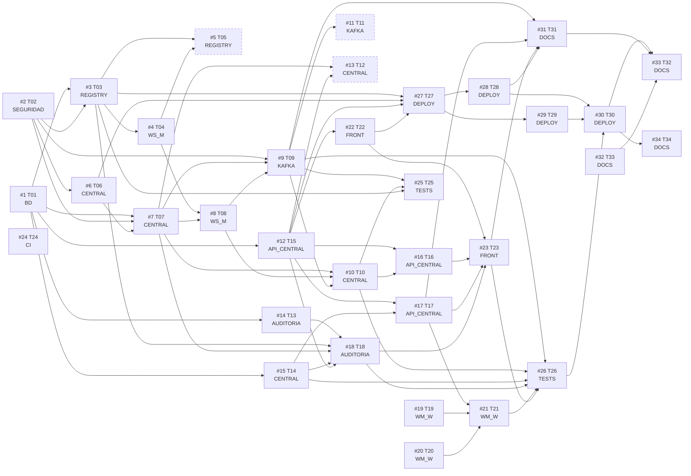

# Release 2 · Dependencias

## 1. Dependencias entre tareas

Cada flecha `A --> B` significa «B necesita A terminada». Las mismas relaciones
están registradas en GitHub como *blocked by* en cada Issue y como sub-issues de
su épica. Las tareas opcionales aparecen con borde discontinuo.

Tareas sin dependencias (pueden empezar ya): [#1](https://github.com/aggg15/Sistemas-Distribuidos/issues/1), [#2](https://github.com/aggg15/Sistemas-Distribuidos/issues/2), [#19](https://github.com/aggg15/Sistemas-Distribuidos/issues/19), [#20](https://github.com/aggg15/Sistemas-Distribuidos/issues/20),
[#24](https://github.com/aggg15/Sistemas-Distribuidos/issues/24), [#32](https://github.com/aggg15/Sistemas-Distribuidos/issues/32).

Ruta crítica: [#2](https://github.com/aggg15/Sistemas-Distribuidos/issues/2) → [#6](https://github.com/aggg15/Sistemas-Distribuidos/issues/6) → [#7](https://github.com/aggg15/Sistemas-Distribuidos/issues/7) → [#8](https://github.com/aggg15/Sistemas-Distribuidos/issues/8) → [#9](https://github.com/aggg15/Sistemas-Distribuidos/issues/9) → [#10](https://github.com/aggg15/Sistemas-Distribuidos/issues/10) → [#25](https://github.com/aggg15/Sistemas-Distribuidos/issues/25)/[#26](https://github.com/aggg15/Sistemas-Distribuidos/issues/26) →
[#27](https://github.com/aggg15/Sistemas-Distribuidos/issues/27) → [#28](https://github.com/aggg15/Sistemas-Distribuidos/issues/28) → [#30](https://github.com/aggg15/Sistemas-Distribuidos/issues/30) → [#33](https://github.com/aggg15/Sistemas-Distribuidos/issues/33).

## 2. Dependencias entre módulos

| Módulo | Depende de | Para |
|---|---|---|
| `common/seguridad.py` (nuevo) | `cryptography`, `ssl`, `hashlib`, `secrets` | Credenciales, cifrado Fernet, contextos TLS |
| `common/auditoria.py` (nuevo) | `common/base_datos.py` | Eventos estructurados |
| `common/base_datos.py` | `sqlite3` | Esquema ampliado y migración |
| WM_Registry (nuevo) | seguridad, base_datos, auditoría | Alta, baja y autenticación por HTTPS |
| WM_Central | protocolo, seguridad, base_datos, auditoría, kafka_utils | TLS, autenticación, claves, cifrado, revocación, clima |
| API_Central | WM_Central (mismo proceso), auditoría | REST de consulta, control y alertas |
| Front (nuevo) | API_Central | Dashboard |
| WM_WS_M | protocolo, seguridad, consola, WM_Registry (HTTPS), WM_Central (TLS) | Menú, alta, autenticación, entrega de la clave |
| WM_WS_E | protocolo, seguridad, kafka_utils, WM_WS_M | Cifrado y descifrado de mensajes |
| WM_FO | kafka_utils | Sin cambios funcionales (solo campo `ip`) |
| WM_W (nuevo) | OpenWeather, API_Central, consola | Clima cada 4 s y alertas |

## 3. Dependencias externas

| Dependencia | Estado | Justificación | Tarea |
|---|---|---|---|
| `kafka-python==3.0.11` | Existente | Cliente Kafka de R1 | — |
| `cryptography` (versión fijada al implementarlo) | Nueva | La biblioteca estándar no incluye cifrado simétrico (Fernet/AES) | [#2](https://github.com/aggg15/Sistemas-Distribuidos/issues/2) |
| `openssl` (CLI) | Herramienta de despliegue | Generar CA y certificados con SAN | [#2](https://github.com/aggg15/Sistemas-Distribuidos/issues/2), [#28](https://github.com/aggg15/Sistemas-Distribuidos/issues/28) |
| apache/kafka 3.9.1 (Docker) | Existente | Broker | — |
| OpenWeather Current weather data | Servicio externo nuevo | Exigido por el PDF (p. 5–8); API key gratuita | [#19](https://github.com/aggg15/Sistemas-Distribuidos/issues/19) |
| AWS Labs (EC2) | Existente | Despliegue cloud (p. 9) | [#28](https://github.com/aggg15/Sistemas-Distribuidos/issues/28) |
| Docker Hub + GitHub Actions | Existente | Publicación de la imagen | [#24](https://github.com/aggg15/Sistemas-Distribuidos/issues/24) |
| Node.js | **No se añade** | Recomendado pero no obligatorio (p. 5); ver ARCHITECTURE.md D7 | [#22](https://github.com/aggg15/Sistemas-Distribuidos/issues/22) |
| Flask / FastAPI | **No se añade** | `http.server` basta (ARCHITECTURE.md D4) | — |

## 4. Dependencias de configuración

| Variable | Componente | Ejemplo / valor por defecto | Secreto |
|---|---|---|---|
| `WM_TLS_CERT`, `WM_TLS_KEY` | CENTRAL, Registry | `certs/servidor.pem`, `certs/servidor.key` | La clave sí |
| `WM_CA_CERT` | Monitor, WM_W, Front | `certs/ca.pem` | No |
| `WM_REGISTRY_URL` | Monitor | `https://IP_AWS:8443` | No |
| `WM_REGISTRY_PORT` | Registry | `8443` | No |
| `WM_HTTP_PORT` | API_Central | `8080` (existente) | No |
| `WM_API_TOKEN` | API_Central, Front | — | Sí |
| `WM_W_TOKEN` | API_Central, WM_W | — | Sí |
| `OPENWEATHER_API_KEY` | WM_W | — | Sí |
| `WM_API_CENTRAL_URL` | Front, WM_W | `http://IP_AWS:8080` | No |
| `WM_FRONT_PORT` | Front | `8000` | No |
| Existentes de R1 | todos | `WM_KAFKA_SERVER`, `WM_DB_PATH`, `WM_SOCKET_PORT`... | No |

Los nombres definitivos se fijan en cada Issue y se recogen en un
`.env.example` sin valores ([#27](https://github.com/aggg15/Sistemas-Distribuidos/issues/27)).
