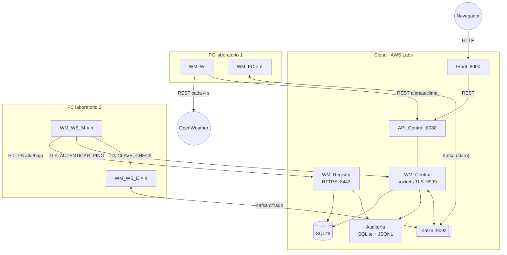

# Release 2 · Plan de implementación

Fecha de entrega según el PDF (p. 9): **semana del 13/12/2026**. Es la única
fecha oficial. El reparto por semanas del apartado 4 es una propuesta interna
del equipo.

Documentos relacionados: [REQUIREMENTS.md](REQUIREMENTS.md) (trazabilidad),
[ARCHITECTURE.md](ARCHITECTURE.md) (contratos y decisiones),
[DEPENDENCIES.md](DEPENDENCIES.md), [TEST_PLAN.md](TEST_PLAN.md),
[AI_USAGE.md](AI_USAGE.md).

## 1. Arquitectura existente

Release 1 está completa y probada (134 pruebas en verde, resiliencia
comprobada el 29/10/2026): CENTRAL atiende a los Monitores por sockets TCP con
el protocolo `<STX>DATA<ETX><LRC>`, coordina los riegos por Kafka con los
Engines y los operarios, persiste en SQLite y sirve un panel web. CENTRAL y
Kafka se despliegan en EC2 (AWS Labs) con una imagen publicada por GitHub
Actions; Monitor, Engine y FO corren en el laboratorio. No hay ningún mecanismo
de seguridad. Detalle en [ARCHITECTURE.md §1](ARCHITECTURE.md#1-arquitectura-actual-release-1-commit-07a4dbd).

## 2. Arquitectura objetivo

Se añaden WM_Registry (REST sobre HTTPS), API_Central (REST, en el proceso de
CENTRAL), Front (web independiente), WM_W (OpenWeather cada 4 s) y tres capas
de seguridad: TLS en el registro y en la autenticación por sockets, cifrado
Fernet con clave única por WS en todos los mensajes CENTRAL ↔ WS, y auditoría
estructurada. Despliegue en tres ubicaciones: cloud, PC1 (FO + WM_W) y PC2 (WS).

## 3. Componentes y comunicaciones



## 4. Orden de implementación recomendado

Cada fase deja `main` funcionando y con las pruebas en verde. Las tareas de una
misma fase sin dependencias entre sí pueden repartirse entre los dos
integrantes.

| Fase | Issues | Resultado verificable | Semana (propuesta interna) |
|---|---|---|---|
| 0. Red de seguridad | [#24](https://github.com/aggg15/Sistemas-Distribuidos/issues/24) CI · [#32](https://github.com/aggg15/Sistemas-Distribuidos/issues/32) registro de IA (continuo) | Las pruebas se ejecutan en cada PR | 17–23/11 |
| 1. Cimientos | [#1](https://github.com/aggg15/Sistemas-Distribuidos/issues/1) BD · [#2](https://github.com/aggg15/Sistemas-Distribuidos/issues/2) criptografía y certificados · [#14](https://github.com/aggg15/Sistemas-Distribuidos/issues/14) auditoría | Migración R1 → R2 probada; primitivas de seguridad probadas | 17–23/11 |
| 2. Registro y autenticación | [#6](https://github.com/aggg15/Sistemas-Distribuidos/issues/6) TLS · [#3](https://github.com/aggg15/Sistemas-Distribuidos/issues/3) Registry · [#4](https://github.com/aggg15/Sistemas-Distribuidos/issues/4) menú del Monitor · [#7](https://github.com/aggg15/Sistemas-Distribuidos/issues/7) autenticación · [#8](https://github.com/aggg15/Sistemas-Distribuidos/issues/8) clave al Engine | Una WS se da de alta, se autentica por TLS y el Engine tiene su clave | 24–30/11 |
| 3. Cifrado y revocación | [#9](https://github.com/aggg15/Sistemas-Distribuidos/issues/9) cifrado Kafka · [#10](https://github.com/aggg15/Sistemas-Distribuidos/issues/10) revocación | Ciclo de riego completo cifrado; revocar y reautenticar | 24/11–3/12 |
| 2–3 en paralelo | [#12](https://github.com/aggg15/Sistemas-Distribuidos/issues/12) API lectura · [#15](https://github.com/aggg15/Sistemas-Distribuidos/issues/15) suspensión climática · [#19](https://github.com/aggg15/Sistemas-Distribuidos/issues/19) OpenWeather · [#20](https://github.com/aggg15/Sistemas-Distribuidos/issues/20) localizaciones · [#17](https://github.com/aggg15/Sistemas-Distribuidos/issues/17) API alertas · [#21](https://github.com/aggg15/Sistemas-Distribuidos/issues/21) ciclo WM_W · [#22](https://github.com/aggg15/Sistemas-Distribuidos/issues/22) Front | WM_W suspende y restaura WS contra una CENTRAL local; Front muestra la API | 24/11–3/12 |
| 4. Cierre funcional | [#16](https://github.com/aggg15/Sistemas-Distribuidos/issues/16) control vía API · [#18](https://github.com/aggg15/Sistemas-Distribuidos/issues/18) auditoría completa · [#23](https://github.com/aggg15/Sistemas-Distribuidos/issues/23) dashboard | Todos los requisitos funcionales demostrables en local | 1–5/12 |
| 5. Integración y despliegue | [#25](https://github.com/aggg15/Sistemas-Distribuidos/issues/25) seguridad · [#26](https://github.com/aggg15/Sistemas-Distribuidos/issues/26) E2E y regresión · [#27](https://github.com/aggg15/Sistemas-Distribuidos/issues/27) contenedores · [#28](https://github.com/aggg15/Sistemas-Distribuidos/issues/28) AWS · [#29](https://github.com/aggg15/Sistemas-Distribuidos/issues/29) PCs · [#30](https://github.com/aggg15/Sistemas-Distribuidos/issues/30) validación | Sistema completo en cloud + 2 PCs con evidencias | 3–10/12 |
| 6. Entrega | [#31](https://github.com/aggg15/Sistemas-Distribuidos/issues/31) documentación · [#33](https://github.com/aggg15/Sistemas-Distribuidos/issues/33) memoria · [#34](https://github.com/aggg15/Sistemas-Distribuidos/issues/34) defensa | Memoria y demo listas | 8–13/12 |
| Opcionales | [#5](https://github.com/aggg15/Sistemas-Distribuidos/issues/5) certificado de WS · [#11](https://github.com/aggg15/Sistemas-Distribuidos/issues/11) seguridad Kafka · [#13](https://github.com/aggg15/Sistemas-Distribuidos/issues/13) REST de autenticación | Solo si las fases 0–5 están cerradas | Si hay margen |

Reparto sugerido para dos personas: un integrante sigue la ruta de seguridad
(T02 → T06 → T07 → T08 → T09 → T10) y el otro la de servicios (T01 → T15 →
T14 → T17 → T19/T20 → T21 → T22 → T23). Ambos se reúnen en la fase 4. Cada PR
lo revisa el otro integrante (requisito de dominio del código, p. 9).

## 5. Dependencias entre módulos

- WM_Registry depende del esquema de BD y del módulo común de seguridad.
- La autenticación en CENTRAL depende de TLS (la clave no puede viajar en claro) y del Registry (credenciales).
- El cifrado de Kafka depende de que Monitor y Engine tengan la clave: no se puede activar antes de [#8](https://github.com/aggg15/Sistemas-Distribuidos/issues/8).
- La revocación depende del cifrado (revocar sin cifrado no tiene efecto real).
- WM_W depende de los endpoints de alertas, y estos de la lógica de suspensión del núcleo.
- El Front depende de API_Central; el dashboard completo, además, de control, alertas y auditoría.
- El despliegue depende de que existan todos los procesos cloud (Registry, CENTRAL con TLS, API, Front).

Grafo completo en [DEPENDENCIES.md](DEPENDENCIES.md).

## 6. Ruta crítica

```text
T02 → T06 → T07 → T08 → T09 → T10 → T25/T26 → T27 → T28 → T30 → T32
#2    #6    #7    #8    #9    #10   #25/#26   #27   #28   #30   #33
```

Son 11 tareas encadenadas, varias de complejidad alta o muy alta ([#9](https://github.com/aggg15/Sistemas-Distribuidos/issues/9)).
Cualquier retraso en la ruta de seguridad retrasa la entrega; por eso arranca la
primera semana y la ruta de servicios avanza en paralelo.

## 7. Riesgos técnicos

| # | Riesgo | Impacto | Mitigación | Issue |
|---|---|---|---|---|
| 1 | Regresiones de R1 al cifrar los mensajes del núcleo | Crítico | CI en cada PR ([#24](https://github.com/aggg15/Sistemas-Distribuidos/issues/24)); el mensaje de R1 viaja intacto dentro del sobre; pruebas REG | [#9](https://github.com/aggg15/Sistemas-Distribuidos/issues/9), [#26](https://github.com/aggg15/Sistemas-Distribuidos/issues/26) |
| 2 | Certificado TLS ligado a la IP de AWS, que cambia al reiniciar el laboratorio | Alto | Elastic IP; script que regenera certificados; la CA se distribuye una vez | [#28](https://github.com/aggg15/Sistemas-Distribuidos/issues/28) |
| 3 | Límite del plan gratuito de OpenWeather (60 llamadas/min, p. 6): a 4 s por ciudad caben 4 ciudades distintas | Medio | Una consulta por ciudad y ciclo; pocas ciudades en la demo; plan de estudiante si hace falta | [#19](https://github.com/aggg15/Sistemas-Distribuidos/issues/19), [#21](https://github.com/aggg15/Sistemas-Distribuidos/issues/21) |
| 4 | No encontrar una ciudad real bajo 0 °C o con lluvia el día de la corrección | Medio | Lista de ciudades candidatas preparada; mock de OpenWeather para la demo local | [#21](https://github.com/aggg15/Sistemas-Distribuidos/issues/21) |
| 5 | Acceso concurrente a SQLite desde CENTRAL y Registry | Medio | WAL, conexión por operación, timeout; pruebas de concurrencia | [#1](https://github.com/aggg15/Sistemas-Distribuidos/issues/1), [#3](https://github.com/aggg15/Sistemas-Distribuidos/issues/3) |
| 6 | Clave en claro en el socket Monitor ↔ Engine si no comparten equipo | Medio | Loopback o TLS en ese socket | [#8](https://github.com/aggg15/Sistemas-Distribuidos/issues/8) |
| 7 | Front público con operaciones de control | Medio | Token de operación solo en el servidor del Front; lecturas públicas | [#16](https://github.com/aggg15/Sistemas-Distribuidos/issues/16), [#22](https://github.com/aggg15/Sistemas-Distribuidos/issues/22) |
| 8 | Fugas de secretos en un repositorio público | Crítico | `.gitignore` ampliado, `.env.example`, revisión con `git grep` antes de cada PR | [#2](https://github.com/aggg15/Sistemas-Distribuidos/issues/2), [#25](https://github.com/aggg15/Sistemas-Distribuidos/issues/25) |
| 9 | Memoria de la instancia EC2 con más contenedores | Medio | `t3.small`/`t3.medium`; heap de Kafka acotado (ya en R1) | [#27](https://github.com/aggg15/Sistemas-Distribuidos/issues/27) |
| 10 | Tiempo: 4 semanas para 30 tareas obligatorias | Crítico | Opcionales al final; ruta crítica primero; ensayo general antes del 10/12 | Plan |

## 8. Estrategia de pruebas

Resumen (detalle en [TEST_PLAN.md](TEST_PLAN.md)):

- **Unitarias** con `unittest` (como en R1), sin red externa: servidores en hilos y puerto 0, BD en ficheros temporales, OpenWeather simulado.
- **Seguridad**: certificados de otra CA, credenciales erróneas, mensajes manipulados o con otra clave, reutilización de claves revocadas, búsqueda de secretos.
- **Integración**: Kafka local con `docker compose`, Registry, CENTRAL+API, Front, WM_W simulado, varias WS y FO.
- **Regresión de R1**: toda la batería en CI y los escenarios de caída de `docs/DISENO.md` §10.
- **Despliegue**: checklist en las tres ubicaciones con capturas.

## 9. Estrategia de despliegue

1. **Local** (cada PR relevante): `docker compose up -d` con todos los servicios cloud y los módulos de laboratorio en el mismo equipo.
2. **Cloud** (AWS Labs, EC2 como en R1): imagen publicada por GitHub Actions solo si pasan las pruebas ([#24](https://github.com/aggg15/Sistemas-Distribuidos/issues/24)); `deploy/arrancar_aws.sh` ampliado para generar certificados con la IP pública y levantar `central`, `registry`, `front` y `kafka` ([#27](https://github.com/aggg15/Sistemas-Distribuidos/issues/27), [#28](https://github.com/aggg15/Sistemas-Distribuidos/issues/28)).
3. **PC1**: varios `WM_FO` y `WM_W`, con `OPENWEATHER_API_KEY` y el token de WM_W en variables de entorno ([#29](https://github.com/aggg15/Sistemas-Distribuidos/issues/29)).
4. **PC2**: varias parejas Monitor/Engine con la CA del proyecto y la URL del Registry ([#29](https://github.com/aggg15/Sistemas-Distribuidos/issues/29)).
5. **Validación**: checklist del apartado 10 sobre el despliegue real ([#30](https://github.com/aggg15/Sistemas-Distribuidos/issues/30)).

Puertos públicos en AWS: 9999 (sockets TLS), 8080 (API_Central), 8443
(Registry), 8000 (Front), 9092 (Kafka). Railway es la alternativa citada en el
PDF; no se usa porque el despliegue en AWS de R1 ya funciona y Railway no
expone TCP arbitrario con la misma facilidad.

## 10. Checklist final de evaluación

Obligatorio (todo debe poder demostrarse en el despliegue real, p. 9):

- [ ] R1 intacta: riego desde FO y desde la WS, telemetría, resumen, bloqueo/activación, fugas y las cuatro caídas (R2-001, R2-042)
- [ ] Alta de una WS desde el menú del Monitor contra WM_Registry por HTTPS; credencial recibida (R2-005…R2-012, R2-030)
- [ ] Baja de una WS y denegación posterior en CENTRAL (R2-006, R2-008)
- [ ] WS sin alta → CENTRAL deniega la autenticación (R2-008)
- [ ] Captura de tráfico Registry y sockets sin datos en claro (R2-010, R2-031)
- [ ] Autenticación con credenciales y clave única por WS (dos WS, claves distintas) (R2-014, R2-015)
- [ ] Mensajes de Kafka CENTRAL ↔ Engine ilegibles con `kafka-console-consumer`; inyección en claro ignorada (R2-016, R2-021)
- [ ] Revocación desde CENTRAL/Front → WS fuera de servicio → reautenticación desde el menú → servicio restaurado (R2-017, R2-018)
- [ ] Auditoría: autenticaciones OK/KO, fuga, cambio de estado, bloqueo, error, alerta; con fecha, IP de WS e IP declarada del FO (R2-023…R2-027)
- [ ] API_Central: consultas de WS, operarios y riegos en curso con GET; operaciones con PUT/DELETE (R2-003, R2-028)
- [ ] WM_W consulta OpenWeather cada 4 s (R2-035, R2-043, R2-044)
- [ ] Cambio de ciudad por menú y por fichero sin reiniciar nada (R2-034)
- [ ] Alerta (T < 0 °C o lluvia) → riego en curso termina normal → WS fuera de servicio; cancelación → WS restaurada (R2-036…R2-038)
- [ ] Front en un navegador externo: WS (registro, activación, token), operarios, errores, mensajes de WM_W, clima y alertas (R2-039, R2-040)
- [ ] Despliegue: cloud (CENTRAL, API, SQLite, Kafka, Front, Registry), PC1 (FO + WM_W), PC2 (varias WS) (R2-045…R2-048)
- [ ] Memoria con portada, componentes, código, guía paso a paso y capturas (R2-049)
- [ ] Prompts de IA incluidos; ambos integrantes explican cualquier parte del código (R2-050)
- [ ] Ningún secreto en el repositorio (R2-D01)

Opcional (valorado):

- [ ] Identificación de WS por certificado autofirmado (R2-011, [#5](https://github.com/aggg15/Sistemas-Distribuidos/issues/5))
- [ ] API REST de autenticación WS ↔ CENTRAL (R2-019, [#13](https://github.com/aggg15/Sistemas-Distribuidos/issues/13))
- [ ] Kafka con SSL/TLS, SASL y ACL (R2-022, [#11](https://github.com/aggg15/Sistemas-Distribuidos/issues/11))

## Primera tarea recomendada

[#24](https://github.com/aggg15/Sistemas-Distribuidos/issues/24) (CI con pruebas): es de complejidad baja, no depende de nada y protege
Release 1 durante todo el desarrollo. Inmediatamente después, [#1](https://github.com/aggg15/Sistemas-Distribuidos/issues/1) y [#2](https://github.com/aggg15/Sistemas-Distribuidos/issues/2) en
paralelo, que desbloquean la ruta crítica.
